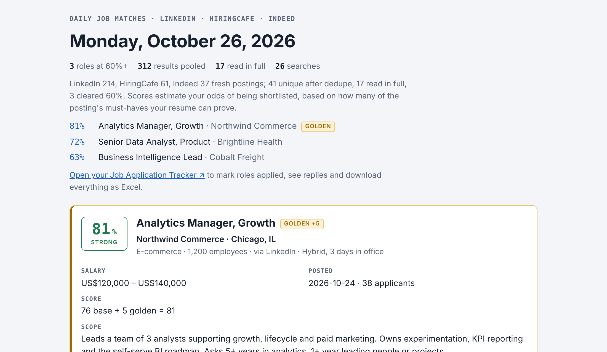
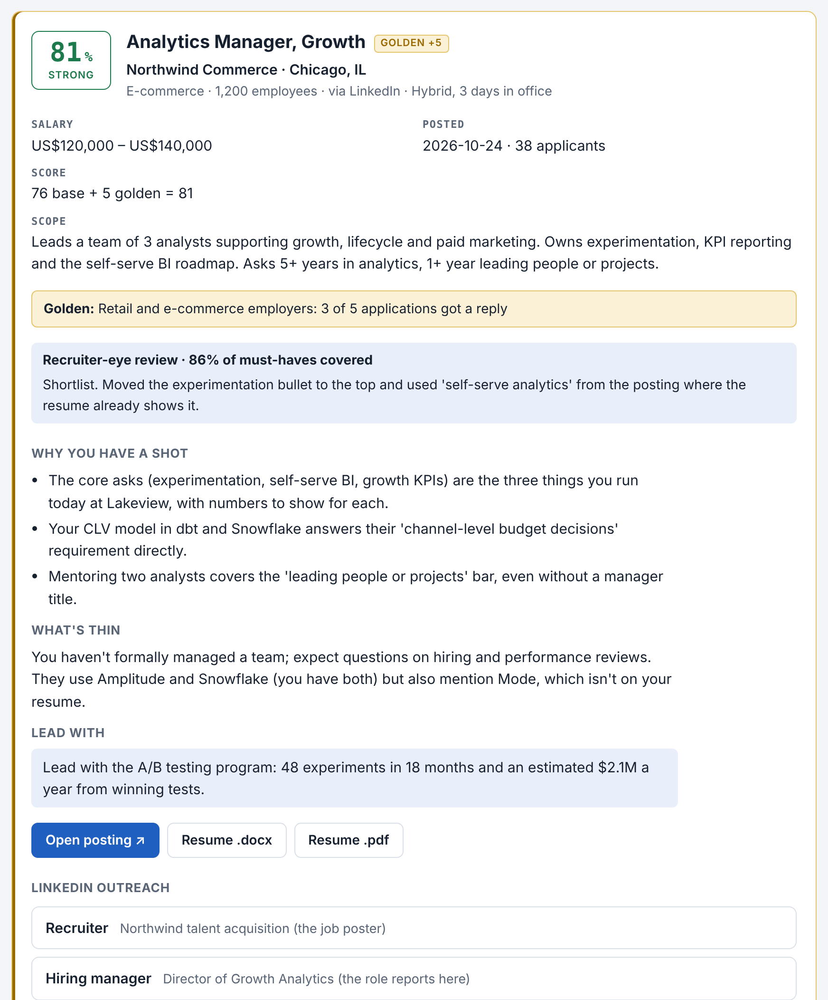
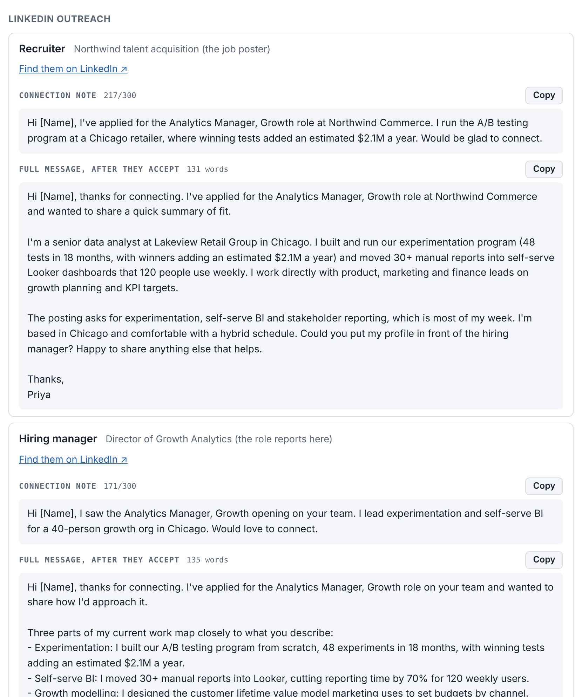
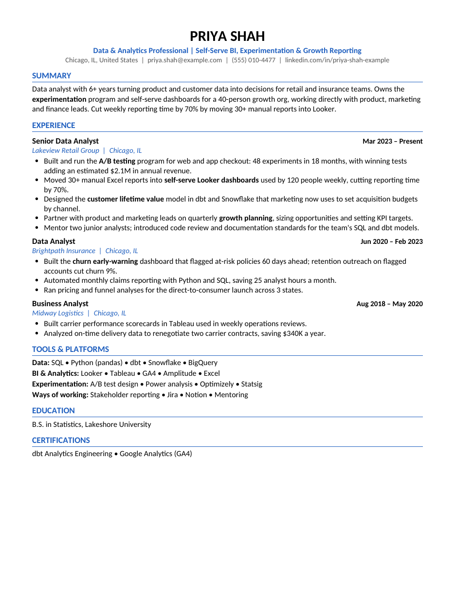
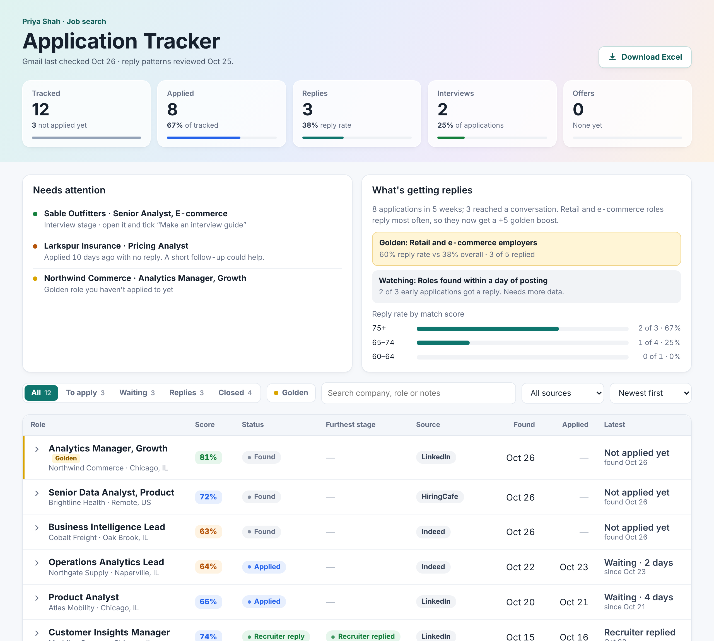

# Job Hunt Assistant

Your job search, done every morning. It finds fresh postings, keeps only the roles where you have a real shot at being shortlisted, and gets each one ready to apply: a tailored resume and the LinkedIn messages to send to the recruiter, the hiring manager and a possible referral.

Nothing about you is built in. The first time you use it, a short interview collects your resume, target roles, location, pay and deal-breakers, and saves them in your own private tracker. It runs as a [skill](https://support.claude.com/en/articles/12512180-using-skills-in-claude) in Claude.

## See it in action

All screenshots use a fictional job seeker and made-up companies.

**Every morning: fresh matches, scored by your odds of being shortlisted**



**A fit assessment for each role: why you have a shot, what's thin, what to lead with**



**Outreach for the recruiter, the hiring manager and a referral: a connection note plus a full message each**



**A resume tailored to each posting, as PDF and Word, using only facts from your real resume**



**An application tracker that reads replies from Gmail and learns which roles get you responses**



## What you get every morning

For each job that clears the 60% bar (at most 10 a day):

- **A fit assessment:** score, why you have a shot, what's thin, and what to lead with.
- **A tailored resume** as PDF and Word, built only from facts on your real resume. Every number is checked against your master resume.
- **LinkedIn outreach for three people** (recruiter, hiring manager, internal referral), each with a connection note of 300 characters or fewer and a full follow-up message.
- **A recruiter-eye review** of the resume on the strongest matches, done by a fresh reader.

Plus:

- **A Job Application Tracker** (a private claude.ai page) that records every role and reads your Gmail for confirmations, interview invites and rejections.
- **A daily email digest** with links to everything.
- **Interview guides** (company research, STAR answers built from your resume, 30-60-90 plan) when an interview comes in.
- **A weekly review** that spots which kinds of roles actually get you replies and gives those a small boost.

## Quick start

1. Download **job-hunt-assistant.zip** from the [latest release](../../releases/latest). Don't unzip it.
2. In Claude: **Settings → Capabilities**, turn on **Code execution and file creation**, then **Skills → Upload skill** and choose the zip.
3. Connect **Gmail** and at least one job source (**Indeed**, **LinkedIn via Apify**, or **HiringCafe**).
4. In a new chat, type: **Use the job-hunt-assistant skill to set up my job hunt**.

The full, plain-language walkthrough is in **[SETUP_GUIDE.md](SETUP_GUIDE.md)**. The release also includes a printable PDF of the guide.

## Requirements

- A paid Claude plan (Pro, Max, Team or Enterprise) with code execution, skills and scheduled tasks.
- Gmail connected to Claude.
- At least one job source connected:
  - **Indeed:** free, from Claude's connector directory.
  - **LinkedIn through [Apify](https://apify.com):** a custom connector at `https://mcp.apify.com`. The free plan includes $5 of monthly credit; a daily LinkedIn pull costs roughly $0.20–1.00, so daily use needs a paid plan.
  - **HiringCafe:** optional, if you have a connector for it.
  - **Other countries:** any job-board connector in Claude's directory can be added during setup.

## What's in this repository

```
job-hunt-assistant/          the skill (zip this folder to upload it)
  SKILL.md                   instructions Claude follows: setup interview, daily run, scoring, messages
  scripts/render_resume.py   builds the tailored resume (.docx and .pdf)
  scripts/build_page.py      builds the daily results page
  scripts/render_guide.py    builds interview guides
  scripts/number_check.py    flags any number not in your master resume
  assets/tracker.html        the Job Application Tracker page
SETUP_GUIDE.md               step-by-step setup for non-technical users
```

To build the zip yourself: `zip -r job-hunt-assistant.zip job-hunt-assistant`

## Privacy

Your resume, answers and applications are saved in your own tracker page on claude.ai, private to your account unless you share it. The skill reads job-related Gmail messages only and never replies, archives or deletes anything; the only email it sends is your daily digest, to you.

## Customizing

Ask Claude in plain words ("make the referral messages more casual", "add product manager roles", "add a cover letter for every job"). Preferences go into your profile; bigger changes update the skill itself. See the last section of the setup guide.

## License

MIT. See [LICENSE](LICENSE).
